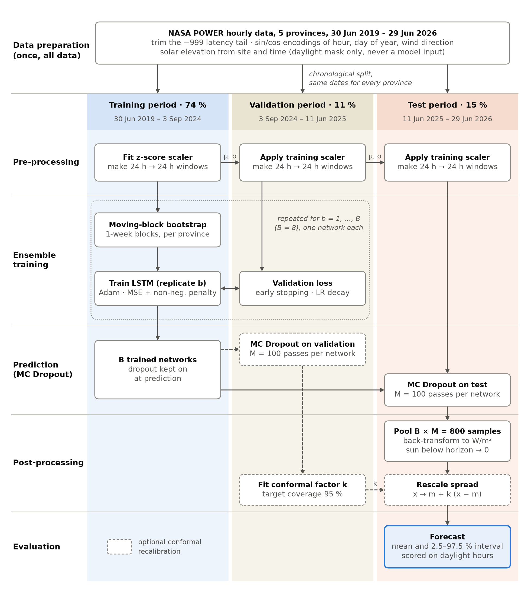
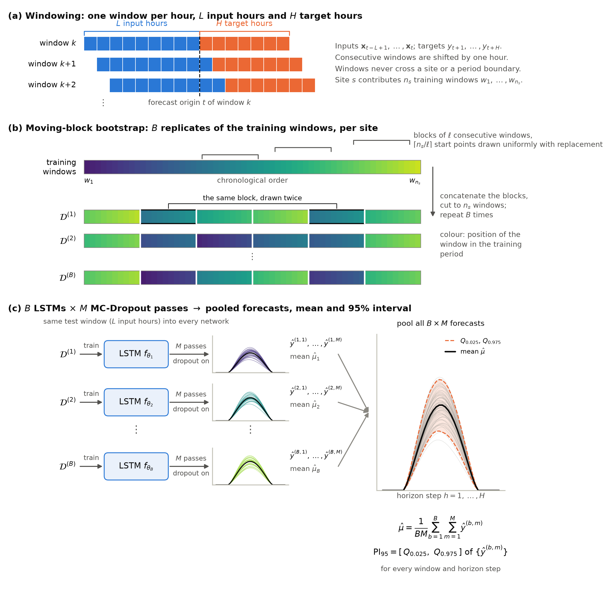
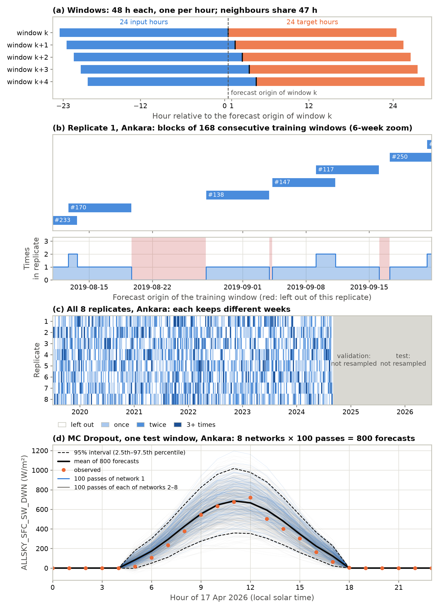
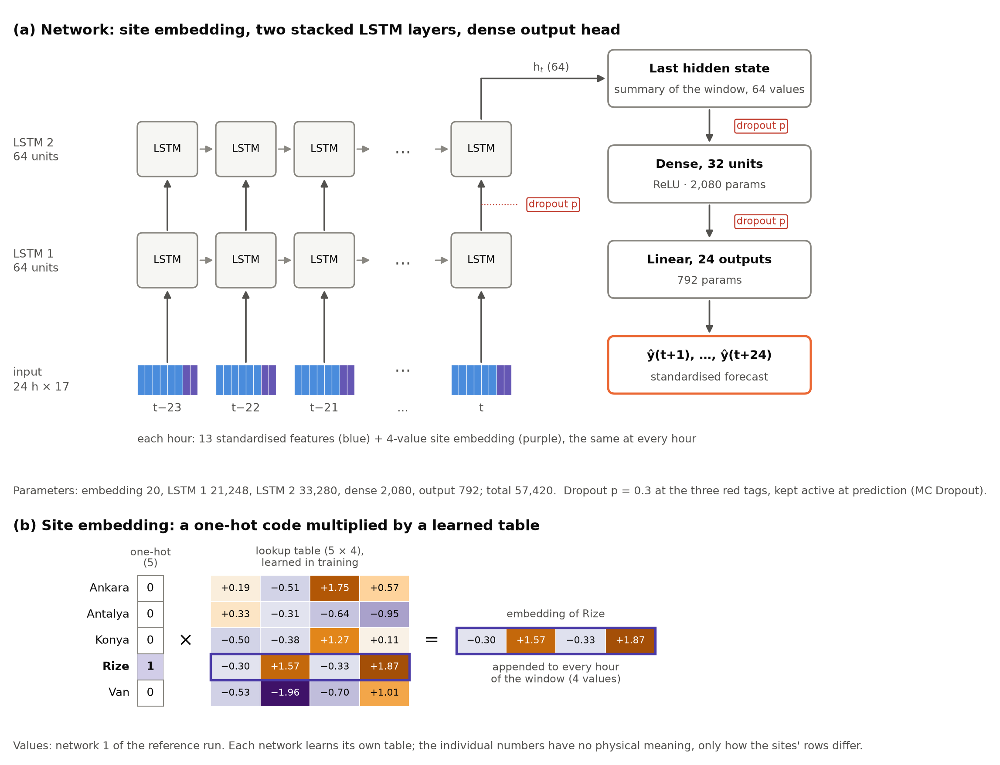
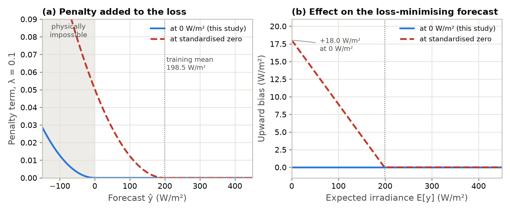
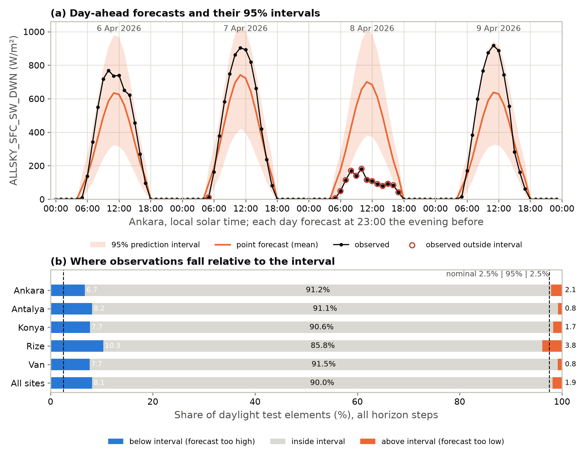
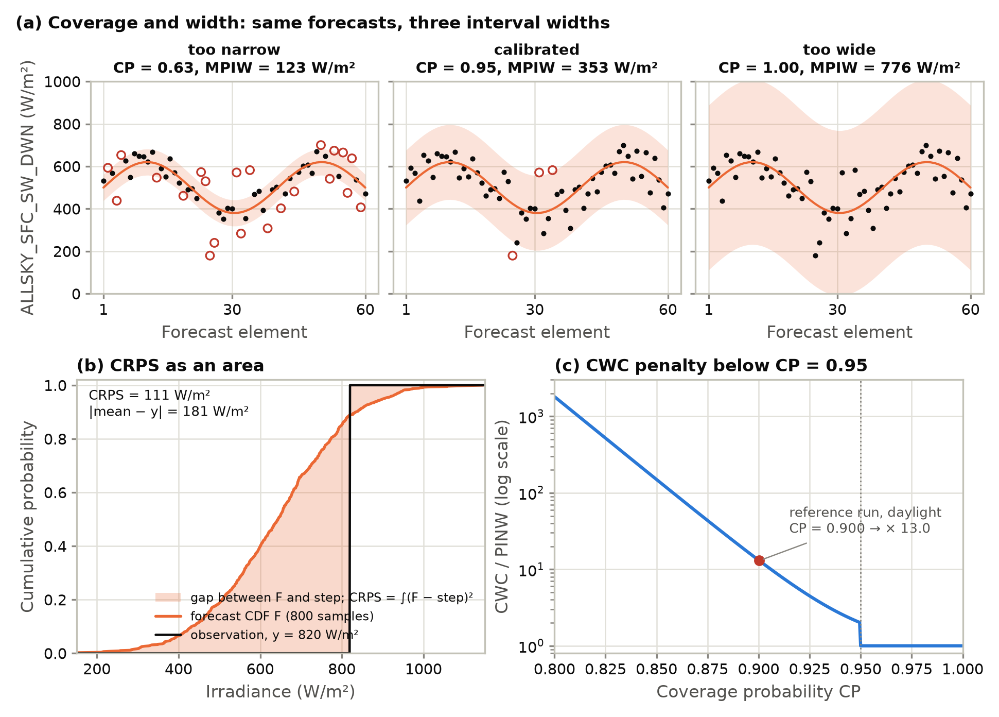

# Methodology

## 1. Overview

The forecasting task is to predict, at every hour, the all-sky surface shortwave downward
irradiance (ALLSKY_SFC_SW_DWN, W/m²) for each of the following 24 hours at five sites in
Türkiye. Point forecasts are produced by a Long Short-Term Memory (LSTM) network, and
predictive uncertainty is quantified by combining a moving-block bootstrap ensemble with Monte
Carlo (MC) Dropout. The combination follows the hybrid ensemble–dropout scheme of Rajaperumal
and Chinnappan, adapted in three respects: an LSTM replaces their physics-constrained
feed-forward backbone, irradiance replaces photovoltaic power as the target, and the bootstrap
resamples contiguous blocks of the training series rather than individual observations.

The procedure consists of the following stages, each described below. The terms *period*,
*window*, *block*, *replicate* and *pass* have precise meanings, defined in Section 2.

1. Split the record chronologically into a training, a validation and a test period, and
   standardise every variable using the training period only.
2. Cut each site's series into overlapping windows of 48 hours: 24 input hours followed by the
   24 hours to be forecast.
3. Build *B* bootstrap replicates of the training windows by drawing blocks of consecutive
   windows with replacement.
4. Train one LSTM on each replicate, with dropout.
5. Run every trained network *M* times on each test window with dropout kept active
   (MC Dropout), giving *B* × *M* forecasts per window.
6. Pool these forecasts into a predictive distribution, from which the point forecast, the
   variance decomposition and the 95% prediction interval are derived.
7. Set forecasts to zero when the sun is below the horizon.
8. Optionally recalibrate the interval width by split-conformal prediction.
9. Evaluate on the test period.

Figure 1 shows the same stages arranged by the period of the data each one uses.



**Figure 1.** The forecasting pipeline, one column per data period. The standardisation and the
bootstrap use the training period only; the validation period drives early stopping and, when
used, conformal recalibration; the test period is only predicted and scored. Dashed boxes are the
optional recalibration step.

## 2. Terminology: hours, periods, windows, blocks, replicates and passes

A single trained network gives a single forecast for each hour, for example 650 W/m² at 12:00
tomorrow, and says nothing about how certain that forecast is. The approach taken here is to
produce many slightly different forecasts for the same hour and to measure how much they
disagree: if they all lie close to 650 W/m² the model is confident, and if they range from 350
to 1000 W/m² it is not. Two independent mechanisms create the differences:

- **Resampling (the bootstrap)** changes the *data* a network learns from. Several training
  sets, called *replicates*, are drawn at random from the original one, and a separate network
  is trained on each.
- **MC Dropout** changes the *network* at prediction time. Each trained network is run
  repeatedly on the same input with a different random subset of its neurons switched off each
  time; each run is a *pass*.

The bootstrap and MC Dropout therefore operate on different objects, and the parameters that
control them are easy to confuse. In particular, the 24-hour input length of a window and the
168-window length of a bootstrap block are unrelated settings, and MC Dropout involves
neither blocks nor resampling.

### 2.1 Definitions

**Table 1.** Terms used throughout, from the smallest unit to the largest. Counts are per site
unless stated otherwise.

| Term | Definition | Size in this study | Used by |
|---|---|---|---|
| Hour | One hourly record of one site, in local solar time | 61,368 per site | All stages |
| Period | One of three consecutive, non-overlapping date ranges: training, validation, test | 45,412 / 6,750 / 9,206 hours | All stages |
| Window | 48 consecutive hours of one site: 24 input hours, then 24 target hours | 45,365 / 6,703 / 9,159 windows | Training and prediction |
| Forecast origin | The last input hour of a window, i.e. the hour at which the forecast is issued | One per window | – |
| Horizon step *h* | One of the 24 target hours of a window, *h* = 1 being the hour after the origin | 24 per window | Evaluation |
| Element | One window at one horizon step; the unit every metric is averaged over | 219,816 test elements | Evaluation |
| Block | ℓ consecutive training windows of one site | ℓ = 168 windows | Bootstrap only |
| Replicate | A resampled copy of the training windows, assembled from blocks | *B* = 8 | Bootstrap only |
| Network | One LSTM, trained on one replicate | *B* = 8 | – |
| Pass | One forward run of a network on a window with a fresh random dropout mask | *M* = 100 per network | MC Dropout only |

### 2.2 Periods

Each site's hourly series is cut at two dates that are the same for all sites:

```
 training period (74%)            validation period (11%)      test period (15%)
|-------------------------------|----------------------------|-------------------------|
30 Jun 2019 00:00    3 Sep 2024 03:00             11 Jun 2025 09:00        29 Jun 2026 23:00
      45,412 hours                     6,750 hours                   9,206 hours
```

The training period is used to fit the standardisation, to build the bootstrap replicates and
to train the networks. The validation period is used for early stopping, learning-rate
scheduling and, when used, conformal recalibration. The test period is used only for
evaluation.

### 2.3 Windows

A window is the unit the network sees: the 24 most recent hours as input, and the following
24 hours as the target.

```
hour:     t−23  t−22  ...  t−1   t   | t+1   t+2   ...  t+24
          <------ 24 input hours ----> <---- 24 target hours ---->
                                     ^
                              forecast origin t
```

Windows are taken at every hour (stride 1), so consecutive windows overlap by 47 of their 48
hours:

```
window k      [ 24 in  | 24 out ]
window k+1     [ 24 in  | 24 out ]
window k+2      [ 24 in  | 24 out ]
                 ...
```

A window is kept only if all 48 of its hours lie inside one period; the 47 windows per site
that would straddle each period boundary are discarded. This is why a period of *H* hours
yields *H* − 47 windows (for example 45,412 − 47 = 45,365 training windows per site). Windows
never mix two sites. The temporal order of the 48 hours inside a window is always preserved, by
construction, whatever happens to the window afterwards.

### 2.4 Blocks and replicates (bootstrap only)

The principle is easiest to see on a training set only ten weeks long. *Resampling* builds a
new training set of the same size by drawing weeks at random and with replacement, as when
drawing numbered balls from a bag and returning each ball after reading it. The result of one
such draw is a *replicate*:

```
original training data:  W1  W2  W3  W4  W5  W6  W7  W8  W9  W10
replicate 1:             W3  W7  W7  W1  W9  W2  W3  W10 W5  W8    (W4, W6 missing; W3, W7 twice)
replicate 2:             W6  W1  W4  W4  W10 W2  W8  W8  W5  W1    (W3, W7, W9 missing)
```

One network is trained on each replicate, so each network has learned from a slightly
different history: the network trained on replicate 1 has never seen the weather of weeks 4
and 6. Where the networks' forecasts disagree, the forecast depends on which history the model
happened to learn from.

Whole weeks are drawn, rather than single hours, because neighbouring hours are nearly
identical. If single hours were drawn, a missing hour would in effect be replaced by its
near-identical neighbour, and every replicate would carry practically the same information.
Drawing weeks means that whole weather episodes are genuinely absent from a replicate, so the
networks differ in a meaningful way.

In the actual procedure the role of a "week" is played by a *block* of 168 consecutive
training windows, which may start at any hour rather than on a fixed weekday. The bootstrap
does not cut the series again and does not create new windows. It takes the
45,365 training windows of one site, in time order, and draws *blocks* of ℓ = 168 consecutive
windows from them:

```
training windows of one site, in time order:   w1  w2  w3  ...  w45365

one block starting at w_j:   w_j, w_j+1, ..., w_j+167
   = 168 forecast origins spanning 7 days (215 hours of data, inputs and targets included)

one replicate for this site: [block at w_9120][block at w_301][block at w_40007] ...
   = 271 randomly placed blocks, joined and cut to exactly 45,365 windows
```

The same is done independently for the other four sites, and the five resampled sets are
pooled into one replicate. Repeating this *B* = 8 times gives eight replicates, and one network
is trained on each.

What the blocks accomplish needs stating precisely. Windows inside a replicate are shuffled
into mini-batches during training, and the network carries no state from one window to the
next, so the order in which blocks are joined plays no role. What the blocks control is
*which* windows enter a replicate, and how often: neighbouring windows, which share most of
their hours and the same weather, are included or left out together, a week at a time. A
replicate is therefore a resampling of weeks of weather rather than of isolated hours, which is
the dependence an independent (window-by-window) bootstrap would ignore. A replicate contains
about 61–65% of the distinct training windows, some of them several times over.

### 2.5 Passes (MC Dropout only)

*Dropout* is a standard training technique: at every training step a random 30% of the
network's neurons are switched off, so that the network cannot rely too heavily on any single
one. Ordinarily dropout is switched off when forecasts are made. MC Dropout keeps it switched
on. The same trained network is then given the same test window *M* = 100 times, and each time
a different random 30% of its neurons is switched off, giving 100 slightly different 24-hour
forecasts:

```
network 1, same test window, pass 1:    12:00 -> 640 W/m²
network 1, same test window, pass 2:    12:00 -> 710 W/m²
network 1, same test window, pass 3:    12:00 -> 590 W/m²
...                                      (100 passes)
```

If these forecasts stay close together, what the network has learned about this situation is
robust; if they scatter, it is not. MC Dropout involves no new data, no resampling and no
retraining, and it uses no periods or blocks: it runs only at prediction time, on the ordinary
test windows, each used once and in no particular order. With *B* = 8 networks, every test
window receives 8 × 100 = 800 forecasts.

For each forecast hour, the 800 values are then summarised. The point forecast is their mean,
and the 95% prediction interval runs from the 2.5th to the 97.5th percentile: the 800 values
are sorted and the lowest 2.5% and highest 2.5% are cut off. For the example in Figure 3(d),
12:00 on 17 April 2026 in Ankara, this gives a forecast of 659 W/m² and an interval of
332–972 W/m².

### 2.6 How the pieces combine

Figure 2 summarises the whole procedure in symbols.



**Figure 2.** Overview of the forecasting and uncertainty-quantification procedure. (a) Each
site's hourly series is cut into overlapping windows of *L* input hours (blue) followed by the
*H* hours to be forecast (orange); a new window starts every hour. (b) Moving-block bootstrap:
for each site, block start points are drawn uniformly with replacement from its *n*<sub>*s*</sub>
chronologically ordered training windows; the blocks of ℓ consecutive windows are concatenated
and cut to *n*<sub>*s*</sub> windows, giving replicate 𝒟<sup>(*b*)</sup>. Colour encodes each
window's position in the training period, so the order is preserved within a block but not
between blocks; a block can be drawn more than once (outlined) and some windows are left out.
The replicates of all sites are pooled, and the procedure is repeated *B* times. (c) One LSTM
is trained on each replicate. Each trained network is run *M* times on the same test window with
dropout kept active, giving forecasts ŷ<sup>(*b*,1)</sup>, …, ŷ<sup>(*b*,*M*)</sup> over the
*H* horizon steps. The *B* × *M* forecasts are pooled; their mean is the point forecast μ̂ and
their empirical 2.5th and 97.5th percentiles bound the 95% prediction interval, separately for
every window and horizon step. Curves are illustrative.

**Table 2.** The two sampling mechanisms compared.

| | Resampling (bootstrap) | MC Dropout |
|---|---|---|
| What is varied | The training data | The network's active neurons |
| When | Before training | At prediction time |
| Which data | Training period only | Test windows (and validation windows, if recalibrating) |
| How many | 8 replicates, hence 8 networks | 100 passes per network |
| Question it answers | Would the forecast change with a different training history? | Is this network's forecast stable? |

Both mechanisms measure uncertainty in the model only. Neither represents the natural
variability of the weather itself, such as a cloud arriving that no model could anticipate, so
the resulting interval is expected to be too narrow; Section 8.5 describes the correction.

Figure 3 shows the same steps on the real data, using the replicates and trained networks of
the reference run.



**Figure 3.** How the data are sampled. (a) Windows: each window holds 24 input hours (blue)
and the 24 hours to be forecast (orange); a new window starts every hour, so neighbouring
windows share 47 of their 48 hours. (b) Bootstrap blocks for one site in replicate 1, over six
weeks of the training period. Each bar is one drawn block of 168 consecutive training windows,
labelled by the order in which it was drawn; the lower plot counts how often each window
appears in the replicate. Windows covered by no block (red) are left out of this replicate, and
where two blocks overlap, the windows appear twice. (c) The same count for all eight replicates
over the whole record, one window per day: every replicate keeps a different set of weeks, and
the validation and test periods are never resampled. (d) MC Dropout on one test window: each of
the eight trained networks is run 100 times with fresh dropout masks (blue: the 100 passes of
network 1; grey: networks 2–8). The 800 forecasts give the mean (solid) and the 95% interval
(dashed); forecasts are zero when the sun is below the horizon.

## 3. Problem formulation

Let *s* ∈ {1, …, 5} index the site and *t* the hour, expressed in each site's local solar time.
Let **x**<sub>*s*,*t*</sub> ∈ ℝ<sup>13</sup> be the standardised feature vector of site *s* at
hour *t* (Section 4) and *y*<sub>*s*,*t*</sub> the observed irradiance. The input of the window
with origin *t* is

<p class="eq">X<sub>s,t</sub> = (<b>x</b><sub>s,t−23</sub>, …, <b>x</b><sub>s,t</sub>),</p>

and its target is the irradiance over the following 24 hours,

<p class="eq">y<sub>s,t</sub> = (y<sub>s,t+1</sub>, …, y<sub>s,t+24</sub>).</p>

The model maps the window and the site identity to all 24 values at once
(direct multi-output forecasting):

<p class="eq">ŷ<sub>s,t</sub> = f<sub>θ</sub>(X<sub>s,t</sub>, s) ∈ ℝ<sup>24</sup>.<span class="eqn">(1)</span></p>

Each horizon step *h* = 1, …, 24 is therefore a separate output of the same network rather
than the result of feeding earlier predictions back as inputs. Only observed quantities enter
the window; no numerical weather prediction or other forecast of the meteorological variables
is used, so the inputs are all available at the time the forecast is issued.

A single model is trained on all five sites jointly. Site identity enters only through a
learned embedding (Section 6), so information can be shared across climates while the
network can still represent site-specific behaviour.

## 4. Input variables and feature engineering

**Input set.** Each hour of a site's record is described by thirteen input features
(Table 3): the lagged target, six meteorological variables, and six features derived from
circular quantities. The meteorological variables are air temperature (T2M), relative humidity
(RH2M), dew/frost point (T2MDEW), surface pressure (PS), wind speed (WS2M) and bias-corrected
precipitation (PRECTOTCORR), all at 2 m. They enter the model in their native units, with no
further transformation. Only observed quantities are used, so every input is available when
the forecast is issued.

**Autoregressive component.** All-sky surface shortwave irradiance (ALLSKY_SFC_SW_DWN) is both
the forecast target and an input. Its values over the 24-hour input window give the network the
recent cloudiness and the current state of the diurnal cycle. This makes the model
autoregressive in irradiance. Because all 24 horizon steps are predicted at once (Section 3),
earlier forecasts are never fed back as inputs.

**Circular encoding of wind direction.** Wind direction is an angle, so a linear
representation would put 359° and 1° at opposite ends of the scale. Wind direction θ is
therefore replaced by the pair (sin θ, cos θ). This maps each direction to a point on the unit
circle and removes the 0°/360° discontinuity.

**Cyclical time encoding.** The diurnal and annual cycles are encoded in the same way. The hour
of day *h* becomes (sin 2π*h*/24, cos 2π*h*/24), and the day of year *d* becomes
(sin 2π*d*/365.25, cos 2π*d*/365.25). With this encoding 23:00 and 00:00, and 31 December and
1 January, are neighbours in feature space. The year length of 365.25 days absorbs leap years.
Timestamps are in each site's local solar time, so a given value of the hour encoding matches
approximately the same solar hour angle at every site.

**Solar geometry as a mask, not a predictor.** Two geometric quantities are computed from each
site's coordinates and the timestamp alone: the apparent solar elevation at the midpoint of
each hour, and the top-of-atmosphere irradiance on a horizontal surface. Neither is a model
input. They define the night-time constraint on the forecasts (Section 9) and the daylight
evaluation subset (Section 10.1). Excluding them keeps the input set free of information the
cyclical time encodings already carry, and keeps the definition of the evaluation subset
separate from what the model learns.

**Site identity.** All five sites are modelled by one network. Site identity is not a
hand-crafted feature: each site gets a learned four-dimensional embedding vector, which is
appended to the feature vector at every hour of the window, giving seventeen inputs per hour
(Section 6). This lets the network share structure across climate zones while still
representing site-specific behaviour. All thirteen features, the target included, are
standardised using statistics from the training period only (Section 5).

**Table 3.** Model inputs.

| Variable | Description | Unit |
|---|---|---|
| ALLSKY_SFC_SW_DWN | All-sky surface shortwave downward irradiance (lagged target) | W/m² |
| T2M | Air temperature at 2 m | °C |
| RH2M | Relative humidity at 2 m | % |
| T2MDEW | Dew/frost point at 2 m | °C |
| PS | Surface pressure | kPa |
| WS2M | Wind speed at 2 m | m/s |
| PRECTOTCORR | Bias-corrected precipitation | mm/h |
| WD2M (sin, cos) | Wind direction at 2 m, sine and cosine | – |
| Hour of day (sin, cos) | 2π · hour / 24 | – |
| Day of year (sin, cos) | 2π · day of year / 365.25 | – |

## 5. Data partitioning, standardisation and windowing

The record (30 June 2019 00:00 – 29 June 2026 23:00, 61,368 hours per site) is divided into the
three periods of Section 2.2, in proportions 74% / 11% / 15%. The boundaries are computed once
and are identical at every site. The test period spans 384 days and covers all four seasons;
the validation period contains no July or August and only the first eleven days of June.

Every variable, the target included, is standardised to zero mean and unit variance, with means
and standard deviations estimated from the training period only and then applied unchanged to
the validation and test periods. For the target these are ȳ = 198.5 W/m² and
*s*<sub>*y*</sub> = 279.7 W/m². Networks are trained on the standardised target, and their
forecasts are transformed back to W/m² before evaluation.

Windows are built as described in Section 2.3. Across the five sites this gives 226,825
training, 33,515 validation and 45,795 test windows.

## 6. Network architecture

The network takes one window and the identity of its site and returns the 24 standardised
forecasts of Eq. 1. It has three parts, shown in Figure 4: a site embedding, a recurrent encoder
of two stacked LSTM layers, and a fully connected output head.



**Figure 4.** (a) Network architecture. Each of the 24 input hours carries 13 standardised
features (blue) and the 4-value embedding of the site (purple). Two stacked LSTM layers read the
hours in order, each passing its state from one hour to the next (grey arrows). The hidden state
of the second layer at the last input hour *t* summarises the window and is passed to a dense
layer and a linear layer with one output per horizon step. Dropout (red) is applied between the
LSTM layers, to the summary state and after the dense layer, and is kept active at prediction
time. (b) The site embedding is a one-hot code of the site multiplied by a learned 5 × 4
table, which selects that site's row; values shown are those of network 1 of the reference run.

### 6.1 Site embedding

A single network serves all five sites, so it must be told which site a window comes from. Site
identity is a category, not a quantity, and the way it is encoded matters:

- **An integer code** (Ankara = 1, …, Van = 5) would impose an order and a distance that do not
  exist: Konya would lie "between" Antalya and Rize, and Van would be "five times" Ankara.
- **A one-hot code** removes this: each site becomes a vector of five binary values with a single
  1 (Rize = (0, 0, 0, 1, 0)). Every site is then equally distant from every other, which is
  neutral but carries no information about which sites behave alike.
- **An embedding**, used here, is a one-hot code followed by a learned table. Multiplying the
  one-hot vector by a 5 × 4 table **E** simply picks out one row of the table (Figure 4b), so
  each site is represented by four real numbers,
  **e**<sub>*s*</sub> = **E**<sub>*s*,·</sub> ∈ ℝ<sup>4</sup>.

The embedding is therefore an encoding of the site, like one-hot encoding, with one difference:
the code values are not fixed by hand but learned. The 20 numbers of **E** are parameters of the
network, initialised at random and updated by the same loss and the same gradient steps as every
other weight. During training, sites whose irradiance responds to the inputs in similar ways
tend to receive similar rows, and sites that behave differently receive different ones.

The site's vector is appended to the 13 features at every one of the 24 input hours, so the LSTM
receives 17 values per hour:

<p class="eq">x̃<sub>s,τ</sub> = (<b>x</b><sub>s,τ</sub>, <b>e</b><sub>s</sub>) ∈ ℝ<sup>17</sup>,&nbsp;&nbsp; τ = t − 23, …, t.<span class="eqn">(2)</span></p>

Repeating it at every hour, rather than adding it once at the end, lets the site change how
every input hour is read. The same relative humidity or the same afternoon irradiance, for
example, can carry a different signal about tomorrow's cloud in humid, coastal Rize than in
continental Van.

Three properties follow. First, the individual numbers of **E** have no physical meaning: each
of the eight networks learns its own table, and any rotation of it would serve equally well, so
only the differences between sites' rows are informative. Second, the embedding is the only
site-specific part of the network; all other weights are shared by the five sites, which is what
allows information to transfer between climates. Third, the network has a row only for the five
sites it was trained on, so it cannot forecast a new site without retraining. Four dimensions are
enough to give five sites distinct positions while adding only 20 parameters.

### 6.2 Recurrent encoder

An LSTM reads a sequence one step at a time and carries an internal memory, its hidden and cell
states, from each hour to the next. At every hour it combines the new input with this memory
through learned gates that decide what to keep, what to forget and what to pass on. After the
last input hour *t* the hidden state is a learned summary of the whole 24-hour window.

The encoder stacks two LSTM layers of 64 hidden units each. The first reads the 17 inputs of
each hour; the second reads the hidden states of the first, hour by hour. Dropout (rate
*p* = 0.3) is applied to the signal passed from the first layer to the second. Only the hidden
state of the second layer at hour *t*, a vector of 64 values, is passed on.

### 6.3 Output head

The 64-value summary goes through dropout (*p* = 0.3), a fully connected layer of 32 units with
ReLU activation, dropout again (*p* = 0.3), and a linear layer with 24 outputs, one per horizon
step. The outputs are standardised irradiance, transformed back to W/m² after prediction
(Section 5). The final layer has no activation, so the outputs are not constrained to be
non-negative; Sections 7.1 and 9 deal with negative values.

**Table 4.** Layers and trainable parameters.

| Layer | Input → output | Parameters |
|---|---|---|
| Site embedding | site → 4 | 20 |
| LSTM layer 1 | 24 × 17 → 24 × 64 | 21,248 |
| LSTM layer 2 | 24 × 64 → 64 (last hour) | 33,280 |
| Dense + ReLU | 64 → 32 | 2,080 |
| Linear output | 32 → 24 | 792 |
| **Total** | | **57,420** |

The network contains no batch normalisation, because MC Dropout runs the network in training
mode at prediction time, where batch normalisation would use the statistics of the prediction
batch rather than fixed ones. Dropout, at the three positions above, is therefore the only
source of randomness at prediction time.

## 7. Training

### 7.1 Loss function

Each network is trained on its replicate by minimising, over mini-batches of *N* windows, the
loss

<p class="eq">𝓛(θ) = (1/24N) Σ<sub>i</sub> Σ<sub>h</sub> (z̃<sub>i,h</sub> − z<sub>i,h</sub>)<sup>2</sup> + λ (1/24N) Σ<sub>i</sub> Σ<sub>h</sub> max(0, z<sub>0</sub> − z̃<sub>i,h</sub>)<sup>2</sup>,<span class="eqn">(3)</span></p>

where *z* = (*y* − ȳ)/*s*<sub>*y*</sub> is the standardised observation, z̃ the standardised
forecast, z₀ the standardised value of 0 W/m² (Section 7.2) and λ = 0.1. The loss has two terms with different jobs.

**The error term** is the mean squared error between forecast and observation over all windows
and horizon steps. It is computed on the standardised scale, on which the network works. A
squared error is minimised by the conditional mean, so the point forecast estimates the expected
irradiance given the inputs.

**The penalty term** encodes a physical fact the error term does not: irradiance cannot be
negative. The output layer is unconstrained (Section 6.3), so nothing else prevents the network
from predicting, say, −20 W/m² near sunrise. The term max(0, −z̃)² is zero when the forecast
respects the constraint and grows with the square of the violation when it does not, so small
violations cost little and large ones much more. In W/m² the term equals
(max(0, −ŷ)/*s*<sub>*y*</sub>)², the squared negative part of the forecast. This is a *soft* constraint: negative forecasts
are discouraged rather than forbidden, which keeps the loss smooth and the gradients informative.
The approach follows the physics-constrained loss of the reference method.

**The penalty constant** λ sets how much a violation costs relative to an error of the same
size. With λ = 0.1, a forecast that is *d* units below the boundary adds as much to the loss as
an ordinary error of √0.1 · *d* ≈ 0.32 *d*; a larger λ enforces the constraint more strictly at
the expense of fitting the observations. The value 0.1 is taken over from the reference method
and has not been tuned.

### 7.2 Placing the penalty at 0 W/m² on the standardised scale

The network predicts standardised irradiance, whose zero is not 0 W/m² but the training-period
mean ȳ = 198.5 W/m². In standardised units, 0 W/m² lies at

<p class="eq">z<sub>0</sub> = (0 − ȳ) / s<sub>y</sub> = −198.5 / 279.7 = −0.71,<span class="eqn">(4)</span></p>

and this is where the penalty of Eq. 3 is placed: a forecast is penalised only if z̃ < z₀, that
is, only if it is negative in W/m². The value of z₀ is computed from the same training-period
statistics as the standardisation itself, so it introduces no information from outside the
training period.

The offset matters. Written naively as max(0, −z̃)², the penalty would act on every forecast
below the training mean rather than below zero (Figure 5a). That range covers about 66% of
training hours, every night hour included, and the penalty would then pull low forecasts towards
the mean: for an element with expected irradiance E[*y*] below ȳ, the squared error plus such a
penalty is minimised by (E[*y*] + λȳ)/(1 + λ), an upward bias of λ(ȳ − E[*y*])/(1 + λ), which
reaches +18.0 W/m² at E[*y*] = 0 and +9.0 W/m² at 100 W/m² (Figure 5b). Placed at z₀, the
penalty is zero for every physically possible forecast and leaves the conditional-mean target of
the error term unchanged.



**Figure 5.** The non-negativity penalty in W/m². (a) Penalty added to the loss as a function of
the forecast, placed at 0 W/m² as in this study, and, for comparison, at the standardised zero
(the training-period mean of 198.5 W/m²). (b) Upward bias that each placement puts on the
loss-minimising forecast, as a function of the expected irradiance.

### 7.3 Optimisation

Optimisation uses Adam with an initial learning rate of 10<sup>−3</sup> and mini-batches of 128
windows, reshuffled every epoch. After each epoch the loss of Eq. 3, penalty included, is
computed on the validation windows with dropout disabled. The learning rate is halved when this
validation loss has not improved for 7 epochs. Training stops when it has not improved for 10
epochs, or after 100 epochs, and the weights from the epoch with the lowest validation loss are
kept. Every network uses the same, unresampled validation windows.

## 8. Uncertainty quantification

### 8.1 Moving-block bootstrap

Meteorological and irradiance series are strongly autocorrelated, so resampling windows
independently would treat near-identical neighbouring windows as independent evidence. A
moving-block bootstrap is used instead (Section 2.4). For site *s* with *n*<sub>*s*</sub>
chronologically ordered training windows and block length ℓ, ⌈*n*<sub>*s*</sub>/ℓ⌉ block start
positions are drawn uniformly and with replacement from {1, …, *n*<sub>*s*</sub> − ℓ + 1}. The
blocks of ℓ consecutive windows are joined and cut to exactly *n*<sub>*s*</sub> windows. This
is repeated for every site, and the five resampled sets are pooled into one replicate:

<p class="eq">𝒟<sup>(1)</sup>, 𝒟<sup>(2)</sup>, …, 𝒟<sup>(B)</sup>.<span class="eqn">(5)</span></p>

With *n*<sub>*s*</sub> = 45,365 and ℓ = 168, each site contributes 271 blocks per replicate.
Resampling site by site keeps the number of windows per site identical in every replicate, so
no replicate is dominated by one climate. Each window carries its own inputs and targets, so
resampling cannot pair an input with the wrong target. The block length of 168 windows (one
week of forecast origins) is chosen to span the diurnal cycle and the multi-day lifetime of
synoptic weather systems. As in any moving-block bootstrap, windows within ℓ − 1 of either end
of a site's training series can be drawn by fewer block positions and so appear less often.

Only training windows are resampled. Validation windows are the same for every replicate and are
used only for early stopping and learning-rate scheduling; test windows take no part in training
or resampling.

**[To be decided: whether to run a block-length sensitivity analysis (ℓ = 24, 72 and
168 windows); it has not been run.]**

### 8.2 Monte Carlo Dropout

One network *f*<sub>θ<sub>b</sub></sub> is trained on each replicate 𝒟<sup>(*b*)</sup>, starting
from a different random initialisation. During training, dropout acts as a regulariser. At
prediction time it is kept active, so each forward pass applies a fresh random dropout mask
**z**<sub>*b*,*m*</sub>, drawn independently for every window. With *M* passes per network,
every input window receives *B* × *M* stochastic forecasts (Section 2.5):

<p class="eq">ŷ<sup>(b,m)</sup> = f<sub>θ<sub>b</sub></sub>(X, s; <b>z</b><sub>b,m</sub>),&nbsp;&nbsp; b = 1, …, B,&nbsp; m = 1, …, M.<span class="eqn">(6)</span></p>

This study uses *B* = 8 and *M* = 100, giving 800 forecasts for every window and horizon step.
All quantities below are computed separately for each element, i.e. for each window and horizon
step.

### 8.3 Predictive mean and variance decomposition

The point forecast is the mean over all *B* × *M* forecasts:

<p class="eq">μ̂ = (1/BM) Σ<sub>b=1</sub><sup>B</sup> Σ<sub>m=1</sub><sup>M</sup> ŷ<sup>(b,m)</sup>.<span class="eqn">(7)</span></p>

The spread of the pooled forecasts has two sources. Writing the mean of network *b* as

<p class="eq">μ̂<sub>b</sub> = (1/M) Σ<sub>m=1</sub><sup>M</sup> ŷ<sup>(b,m)</sup>,<span class="eqn">(8)</span></p>

the variability within each network due to dropout is

<p class="eq">σ<sup>2</sup><sub>MC</sub> = (1/B) Σ<sub>b=1</sub><sup>B</sup> (1/M) Σ<sub>m=1</sub><sup>M</sup> (ŷ<sup>(b,m)</sup> − μ̂<sub>b</sub>)<sup>2</sup>,<span class="eqn">(9)</span></p>

and the variability between networks due to the bootstrap replicates is

<p class="eq">σ<sup>2</sup><sub>boot</sub> = (1/B) Σ<sub>b=1</sub><sup>B</sup> (μ̂<sub>b</sub> − μ̂)<sup>2</sup>.<span class="eqn">(10)</span></p>

By the law of total variance, their sum is exactly the variance of the pooled forecasts:

<p class="eq">σ<sup>2</sup><sub>epi</sub> = σ<sup>2</sup><sub>MC</sub> + σ<sup>2</sup><sub>boot</sub> = (1/BM) Σ<sub>b</sub> Σ<sub>m</sub> (ŷ<sup>(b,m)</sup> − μ̂)<sup>2</sup>.<span class="eqn">(11)</span></p>

Both components describe uncertainty about the model, that is, epistemic uncertainty: how much
the conditional-mean forecast would change with different training data (σ²<sub>boot</sub>) and
under the approximate posterior over network weights that MC Dropout represents
(σ²<sub>MC</sub>). Reporting the two separately shows how much each part of the ensemble
contributes. **[Known issue: the pipeline currently stores only the total, σ<sub>epi</sub>; the
two components require a small change to be reported.]**

### 8.4 Prediction interval

The nominal 95% prediction interval is given by the empirical 2.5th and 97.5th percentiles of
the *B* × *M* pooled forecasts:

<p class="eq">PI<sub>95</sub> = [Q<sub>0.025</sub>({ŷ<sup>(b,m)</sup>}), Q<sub>0.975</sub>({ŷ<sup>(b,m)</sup>})].<span class="eqn">(12)</span></p>

Because the interval is taken from the pooled sample rather than from a Gaussian assumption, it
can be asymmetric, which arises naturally when the networks disagree in one direction.

**What the interval states.** For one site, one forecast hour and one issue time, the interval
is a range of irradiance values, for example 396–1009 W/m² for 12:00 on 7 April 2026 in
Ankara, forecast at 23:00 the evening before. Its claim is about frequency, not about a single
hour: if the intervals are well calibrated, then over many forecasts the observation falls
inside the interval 95% of the time, below it 2.5% of the time and above it 2.5% of the time.
Whether one particular interval contains its observation says little; the share of intervals
that do, over the test period, is what is measured (Section 10.3).

**How to read it.** Figure 6(a) shows four consecutive day-ahead forecasts from the reference
run, and illustrates four points.

- *Width is the model's uncertainty.* The interval is narrow at dawn and dusk, where irradiance
  is low whatever the weather, and widest around solar noon, where the difference between a
  clear and an overcast sky is largest. Its width also changes from day to day with how
  confident the ensemble is.
- *The point forecast is an expectation, not the most likely value.* On the clear days of 7 and
  9 April the observation lies well above the forecast mean (at 12:00 on 7 April, 893 W/m²
  against a mean of 723 W/m²), yet inside the interval. The mean is pulled down because, given
  only the previous 24 hours, a cloudy day remains possible; the upper part of the interval
  shows what a clear day would deliver.
- *An observation outside the interval is an event the model did not consider plausible.* The
  heavily overcast 8 April was not anticipated: at 12:00 the observation was 108 W/m² against
  an interval of 373–986 W/m², and every daylight hour of that day falls below the interval.
  Such days are where coverage is lost.
- *At night the interval is zero by construction* (Section 9), so night hours carry no
  information about calibration.

Figure 6(b) checks the interval over the whole test period. Pooled over sites, 90.0% of daylight
observations fall inside the interval instead of 95%, and the misses are lopsided: 8.1% fall
below the lower bound and 1.9% above the upper bound, against 2.5% each for a calibrated
interval. The dominant failure is therefore an unexpectedly cloudy hour, as on 8 April, rather
than an unexpectedly clear one. Rize, the cloudiest site, has the lowest coverage (85.8%). This
under-coverage is expected, because the interval represents uncertainty about the model only
(Section 8.5).

**Use in practice.** A calibrated interval gives each forecast hour three usable numbers. The
lower bound is a conservative planning value: irradiance falls below it only 2.5% of the time,
so it can be used, for example, to decide how much solar generation to count on when scheduling
reserves. The upper bound bounds the plausible maximum, relevant for curtailment or inverter
loading. The width flags the hours and days on which the forecast deserves less trust and more
backup capacity. These readings are valid only once the coverage matches its nominal level: in
the reference run the lower bound is crossed 8.1% of daylight hours rather than 2.5%, so it
would overstate the generation that can be relied on until the interval is recalibrated
(Section 8.5).



**Figure 6.** Reading the prediction interval (reference run, test period). (a) Day-ahead
forecasts for Ankara, 6–9 April 2026, each day forecast from the window ending at 23:00 the
evening before: observation (black), point forecast (orange line) and 95% prediction interval
(shaded). Circled observations fall outside the interval. (b) Share of daylight test elements,
over all horizon steps, whose observation falls below, inside or above the interval, per site
and pooled; dashed lines mark the nominal 2.5% and 97.5%.

### 8.5 Aleatoric uncertainty and interval recalibration

Every network outputs a single value per horizon step, so the pooled forecasts describe
uncertainty about the conditional mean only. They contain no term for the variability of the
observation around that mean (aleatoric uncertainty), which in irradiance is dominated by cloud
processes that a 24-hour history cannot resolve. The pooled interval is therefore expected to
cover fewer than 95% of observations.

This can be corrected by split-conformal recalibration on the validation period. The pooled
forecasts for each element are rescaled about their own mean,

<p class="eq">ŷ<sup>(b,m)</sup> → μ̂ + k (ŷ<sup>(b,m)</sup> − μ̂),<span class="eqn">(13)</span></p>

so the point forecast, and hence every point-accuracy metric, is unchanged, while the interval
endpoints and the whole predictive distribution scale together. To estimate *k*, every network
is also run *M* times on each validation window, exactly as on the test windows. For each
validation element with observation *y* and interval [*L*, *U*], the conformity score is the
smallest factor that would have covered it:

<p class="eq">r = (y − μ̂) / (U − μ̂) if y ≥ μ̂,&nbsp;&nbsp; r = (μ̂ − y) / (μ̂ − L) otherwise.<span class="eqn">(14)</span></p>

Given *n* scores, *k* is the ⌈(*n* + 1)(1 − α)⌉-th smallest, with α = 0.05. Factors are
estimated separately for each cell of a grid defined by **[to be decided: the grid, e.g. site
× season]**; cells with fewer than 200 usable scores fall back to the pooled factor. Night-time
elements, where forecast and observation are both zero, carry no information about the interval
width and are excluded from calibration. The reference run reported here uses no recalibration.

Two limitations follow from the data. First, the validation period also serves for early
stopping, so the calibration data are not entirely independent of training decisions; the
dependence is weak, because early stopping selects only the epoch. Second, the validation period
contains no July or August and only the first eleven days of June, so the summer factors are
extrapolated from the other months.

## 9. Physical constraint at night

Daylight is defined geometrically: an hour is a daylight hour if the apparent solar elevation at
the midpoint of the hour, computed from the site coordinates and the timestamp, is above zero.
When the sun is below the horizon, irradiance is physically zero. For every such element, all
*B* × *M* forecasts are set to zero, so the point forecast and both interval endpoints are zero.
The constraint uses only site and time, so it is available when the forecast is issued, and it
is applied identically to every model.

## 10. Evaluation

### 10.1 Evaluation subsets

All metrics are computed on the test period, over every test window and all 24 horizon steps,
and reported for two subsets: all hours, and daylight hours only (solar elevation > 0). About
half of all elements are night hours whose observation and (constrained) forecast are both
exactly zero. These lower RMSE and MAE, inflate R² because the day–night cycle dominates the
total variance, and are covered by every interval by construction. **Daylight metrics are
therefore the headline results**; all-hours metrics are given for completeness.

Because test windows overlap, each test hour appears as a target in up to 24 windows, once at
each horizon step. Metrics are averages over elements, so every hour is counted once per horizon
step at which it is forecast.

Results are reported pooled over the five sites, for each site, pooled over the four sites other
than Rize (which forms a distinct radiative regime), and for each horizon step.

### 10.2 Point-forecast metrics

With μ̂<sub>*i*</sub> the point forecast and *y*<sub>*i*</sub> the observation over the *N*
elements of a subset:

<p class="eq">RMSE = √[(1/N) Σ<sub>i</sub> (μ̂<sub>i</sub> − y<sub>i</sub>)<sup>2</sup>],&nbsp;&nbsp; MAE = (1/N) Σ<sub>i</sub> |μ̂<sub>i</sub> − y<sub>i</sub>|,&nbsp;&nbsp; R<sup>2</sup> = 1 − Σ<sub>i</sub>(y<sub>i</sub> − μ̂<sub>i</sub>)<sup>2</sup> / Σ<sub>i</sub>(y<sub>i</sub> − ȳ<sub>sub</sub>)<sup>2</sup>,<span class="eqn">(15)</span></p>

where ȳ<sub>sub</sub> is the mean observation of the subset.

### 10.3 Probabilistic metrics

Point metrics judge only the mean of the 800 forecasts. Probabilistic metrics judge the interval
and the predictive distribution, along two properties that pull in opposite directions:

- **Calibration**: do the stated probabilities hold? A 95% interval should contain the
  observation 95% of the time.
- **Sharpness**: how narrow is the interval? A narrower interval is more useful, provided it is
  still calibrated.

Neither property is meaningful alone. An interval from 0 to 1,200 W/m² covers every observation
and is useless; a very narrow interval looks precise but misses often. Figure 7(a) shows the
trade-off on the same point forecasts with three interval widths: too narrow (coverage 0.63),
calibrated (0.95) and too wide (1.00, at more than twice the width).

With [*L*<sub>*i*</sub>, *U*<sub>*i*</sub>] the 95% interval of element *i*, *y*<sub>*i*</sub>
its observation, 1 − α = 0.95 the nominal coverage and *N* the number of elements in the subset:

<p class="eq">CP = (1/N) Σ<sub>i</sub> 𝟙(L<sub>i</sub> ≤ y<sub>i</sub> ≤ U<sub>i</sub>),&nbsp;&nbsp; Reliability = |CP − (1 − α)|,&nbsp;&nbsp; MPIW = (1/N) Σ<sub>i</sub> (U<sub>i</sub> − L<sub>i</sub>),&nbsp;&nbsp; PINW = MPIW / (max y − min y),<span class="eqn">(16)</span></p>

<p class="eq">CWC = PINW · [1 + γ exp(−η (CP − (1 − α)))],&nbsp;&nbsp; γ = 1 if CP &lt; 1 − α, else 0,&nbsp;&nbsp; η = 50,</p>

<p class="eq">CRPS = (1/N) Σ<sub>i</sub> [ (1/S) Σ<sub>j</sub> |ŷ<sub>i</sub><sup>(j)</sup> − y<sub>i</sub>| − (1/2S<sup>2</sup>) Σ<sub>j</sub> Σ<sub>j′</sub> |ŷ<sub>i</sub><sup>(j)</sup> − ŷ<sub>i</sub><sup>(j′)</sup>| ],<span class="eqn">(17)</span></p>

where the range in PINW is taken over the subset and the CRPS uses the *S* = *B* × *M* pooled
forecasts ŷ<sub>*i*</sub><sup>(*j*)</sup> of each element. Table 5 explains each metric and
gives its daylight value for the reference run.

**Table 5.** Probabilistic metrics, with the pooled daylight values of the reference run.

| Metric | Question it answers | Ideal | Reference run | Reading |
|---|---|---|---|---|
| CP (coverage probability) | What share of observations fall inside the interval? | 0.95 | 0.900 | 10% of observations missed instead of 5%: the interval is too narrow |
| Reliability | How far is CP from 0.95? | 0 | 0.050 | Distance only; does not say whether the interval is too narrow or too wide |
| MPIW (W/m²) | How wide is the interval on average? | As small as possible at CP ≈ 0.95 | 382 | On average the interval spans 382 W/m² |
| PINW | How wide, relative to the range of the observations? | As small as possible at CP ≈ 0.95 | 0.370 | The interval spans 37% of the observed range (1,033 W/m²); comparable across sites |
| CWC | Width, penalised for under-coverage | PINW itself (no penalty) | 4.80 | PINW multiplied by 13.0 for missing the nominal coverage |
| CRPS (W/m²) | How far is the whole forecast distribution from the observation? | 0 | 54.5 | Comparable with MAE; the point forecast's daylight MAE is 77.2 W/m² |

**CP and Reliability** measure calibration. CP is the first number to check: if it is clearly
below 0.95 the interval is over-confident, and the widths below describe an interval that does
not deliver what it states. Reliability is the absolute distance from 0.95 and is useful for
ranking, but loses the direction, so CP is reported alongside it. Because about half of all
elements are night hours whose interval covers by construction, CP is judged on daylight hours.

**MPIW and PINW** measure sharpness. MPIW is in W/m² and easy to interpret for one site; PINW
divides it by the range of the observations so that sites and subsets with different irradiance
levels can be compared. Width is only a merit at adequate coverage: of two runs, the narrower is
better only if both have CP close to 0.95.

**CWC** combines the two into one number. When CP reaches 0.95 it equals PINW; when CP falls
short, PINW is multiplied by 1 + exp(50 × shortfall), so every 0.01 of missing coverage multiplies
the penalty term by e<sup>0.5</sup> ≈ 1.65 (Figure 7c). The reference run's shortfall of 0.050
gives a factor of 13.0, turning a PINW of 0.370 into a CWC of 4.80. Two consequences follow. CWC
is dominated by coverage whenever CP < 0.95, so it mostly re-expresses CP; and it jumps at
CP = 0.95, where the factor drops from 2 to 1. It is therefore reported for comparability with
the literature, but runs are not ranked on it alone.

**CRPS** (continuous ranked probability score) evaluates the entire predictive distribution, not
only its 2.5th and 97.5th percentiles. Geometrically, it is the squared distance between the
cumulative distribution of the 800 forecasts and a step function that jumps from 0 to 1 at the
observed value (Figure 7b). It is low when much of the forecast probability lies close to what
happened. The first term of Eq. 17 is the mean absolute error of the individual forecasts; the
second subtracts half their mean spread, so spread is credited only insofar as it covers the
error. For a single deterministic forecast the spread is zero and CRPS reduces to the absolute
error. CRPS is therefore in W/m² and directly comparable with the MAE of a point forecast. In
the reference run, the daylight CRPS of 54.5 W/m² is lower than the MAE of the model's own point
forecast (77.2 W/m²): the distribution carries information that its mean alone does not.



**Figure 7.** The probabilistic metrics. (a) The same point forecasts and observations with three
interval widths: coverage alone rewards the widest interval, width alone the narrowest; values are
illustrative. (b) CRPS for one forecast: the cumulative distribution of 800 forecasts (orange)
and the observation as a step (black); the CRPS integrates the squared gap between them over all
irradiance values, here 111 W/m², against an absolute error of the mean of 181 W/m²
(illustrative). (c) The CWC multiplier applied to PINW as a function of CP; the point marks the
reference run's daylight CP of 0.900.

**How to use them.** A run is judged in the following order, on daylight hours, and only against
runs evaluated on the same subset and with the same number of replicates and passes:

1. **Coverage first.** Is CP close to 0.95, overall, per site and per horizon step? If it is
   clearly lower, the interval is over-confident and must be recalibrated (Section 8.5) before
   its width is compared with anything.
2. **Then sharpness.** Among runs with adequate coverage, the one with smaller MPIW and PINW is
   preferred.
3. **CRPS as the overall score.** It rewards calibration and sharpness together, needs no
   choice of interval level, and is comparable with the MAE of point forecasts.
4. **CWC for comparison with published work**, not as the deciding criterion.

### 10.4 Benchmarks

**[To be decided: the benchmark methodology will be declared separately.]**

## 11. Reproducibility

Each experiment is fully specified by a configuration file and a master random seed. The
resampling generator is seeded from the master seed, and network *b* is initialised from
seed + *b*, so the replicates and their initialisations are reproducible. Results are
reproducible on the same hardware backend; different backends do not agree bit for bit. The
reference run was trained in PyTorch on an Apple-silicon GPU (MPS backend).

**[To be updated: the reference-run values quoted in this document (Sections 2.5, 8.4 and 10.3,
Table 5) and Figures 3, 4(b), 6 and 7(c) come from a run trained with the penalty at the
standardised zero rather than at 0 W/m² (Section 7.2). They will be regenerated from the rerun
with the corrected penalty.]**
