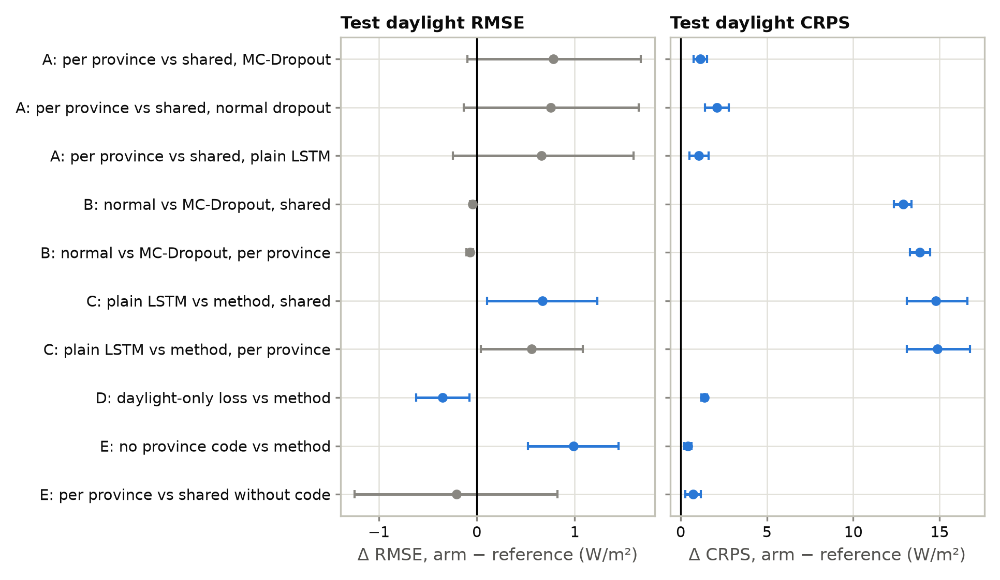

# Ablation findings

This document reports and explains the results of the ablation experiments. It is written for a
reader who does not know the project. The design (why each experiment was run and how it was set
up) is in `ABLATION_PLAN.md`; this document can be read on its own.

All numbers come from `outputs/ablation/`, produced by `scripts/18_ablation_report.py` from the
committed run outputs (16 new runs plus the final method's runs `final_s42` to `final_s44`).
Results date: 2026-10-30.

## 1. Summary in five sentences

1. **The method beats the plain LSTM benchmark by 25% in CRPS** (43.5 vs 58.3 W/m²), while its
   central forecast is almost exactly as accurate (RMSE 0.7 W/m² better, MAE equal). The gain is
   the value of forecasting a range instead of one number.
2. **MC-Dropout is the part that makes the range good.** Without it, the same 6 networks need
   their range widened 7 times instead of 1.8 times, and CRPS rises by 12.9 W/m² (+30%). It does
   not improve the central forecast at all.
3. **One model for all provinces beats one model per province**: MAE 1.7 W/m² and CRPS
   1.1 W/m² better, in all three model types. The gain is largest in Ankara and Antalya.
4. **The province code helps, but only a little**: without it, RMSE rises by 1.0 W/m² and CRPS
   by 0.4 W/m², mostly in Rize and Ankara. Even without the code, the shared model still beats
   one model per province in CRPS.
5. **Training on daylight hours only is a trade-off**: the central forecast improves (MAE
   1.5 W/m² better), but the range gets worse (CRPS 1.4 W/m² worse). The final method keeps the
   all-hours loss, because its main score is CRPS.

## 2. Background needed to read the results

### 2.1 The forecast

We forecast solar irradiance (the power of sunlight reaching the ground, in W/m²) for each of
the next 24 hours, in five Turkish provinces: Ankara, Antalya, Konya, Rize and Van. The final
method gives **600 forecast values per hour**. They come from 6 LSTM networks, each run 100 times
with dropout switched on (MC-Dropout). Their average is the **central forecast**. Their spread,
after a **conformal correction** that widens it until it covers the truth 95% of the time on
validation data, is the **95% range**.

### 2.2 The metrics

All numbers are on the **test year** (11 June 2025 to 29 June 2026), **daylight hours only**
(sun above the horizon). At night the irradiance and every forecast are exactly zero, which would
make every arm look better without saying anything.

| Metric | What it measures | Unit | Better when |
|---|---|---|---|
| **RMSE** | Typical error of the central forecast, with large errors weighted more (square root of the mean squared error). Sensitive to badly missed cloudy hours. | W/m² | Lower |
| **MAE** | Average size of the error of the central forecast. | W/m² | Lower |
| **R²** | Share of the hour-to-hour variation explained by the central forecast (1 = perfect). | none | Higher |
| **Bias** | Average of forecast minus observation. Positive = the forecast is too high on average. | W/m² | Closer to 0 |
| **CP** (coverage) | Share of hours whose observed value fell inside the 95% range. Target: 0.95. Lower means overconfident. | none | Close to 0.95 |
| **MPIW** | Average width of the 95% range. A range that is too wide is always right but useless. | W/m² | Narrower, at CP ≈ 0.95 |
| **PINW** | MPIW divided by the range of the observed values. Unit-free version of MPIW. | none | Lower, at CP ≈ 0.95 |
| **CRPS** | One score for the whole forecast distribution: it rewards distributions that are centred on the truth and no wider than needed. For a single-number forecast it equals MAE, so it compares range forecasts and single-number forecasts fairly. | W/m² | Lower |

**Raw and corrected.** "Raw" CP and width are before the conformal correction; the others are
after it. The **correction factor k** says how much the raw range had to be widened (k = 2 means
twice as wide). A large k means the raw spread said little about the real uncertainty.

### 2.3 When is a difference real?

Each comparison is made **seed by seed**: two runs with the same seed see the same training
randomness, so their difference is fairer than a difference of averages. Ensemble arms have
2 seeds (42, 43), the plain LSTM 3 seeds (42, 43, 44). A difference is called **real** when all
three hold:

1. it has the same sign for every seed;
2. its average is larger than 0.3 W/m², three times the seed-to-seed variation of the final
   method;
3. its **95% confidence interval** excludes zero. Both arms forecast the same days, so the
   interval comes from resampling whole weeks of test days (paired moving-block bootstrap,
   2,000 resamples, blocks of 7 days).

The interval measures how much the result depends on which days happen to be in the test year.
Rule 1 covers training randomness. In the tables, **\*** marks a real difference.

A difference is always **arm minus reference**: positive means the arm is **worse** on an error
metric (RMSE, MAE, CRPS).

## 3. All results in one table

Test year, daylight hours, mean ± sd over seeds.

| Arm | RMSE | MAE | R² | CRPS | CP | MPIW | Raw CP | Raw MPIW | k | Bias |
|---|---|---|---|---|---|---|---|---|---|---|
| **Final method** (shared, MC-Dropout) | 85.94 ± 0.05 | 58.35 ± 0.29 | 0.906 | **43.54 ± 0.03** | 0.953 | 340.6 | 0.818 | 191.7 | 1.79 | +1.4 |
| Per province, MC-Dropout | 86.72 ± 0.05 | 60.08 ± 0.16 | 0.905 | 44.67 ± 0.03 | 0.955 | 351.3 | 0.822 | 198.6 | 1.78 | +2.0 |
| Shared, normal dropout | 85.90 ± 0.05 | 58.23 ± 0.29 | 0.906 | 56.43 ± 0.56 | 0.954 | 390.7 | 0.313 | 56.2 | 7.03 | +1.0 |
| Per province, normal dropout | 86.65 ± 0.06 | 59.88 ± 0.16 | 0.905 | 58.52 ± 0.01 | 0.957 | 404.3 | 0.312 | 60.6 | 6.73 | +1.6 |
| **Plain LSTM benchmark**, shared | 86.56 ± 0.18 | 58.27 ± 0.69 | 0.905 | 58.27 ± 0.69 | n/a | n/a | n/a | n/a | n/a | +1.0 |
| Plain LSTM benchmark, per province | 87.22 ± 0.58 | 59.32 ± 0.62 | 0.904 | 59.32 ± 0.62 | n/a | n/a | n/a | n/a | n/a | +4.0 |
| Daylight-only loss | 85.59 ± 0.17 | 56.84 ± 0.52 | 0.907 | 44.91 ± 0.19 | 0.952 | 376.7 | 0.793 | 182.6 | 2.07 | +1.3 |
| No province code | 86.93 ± 0.66 | 58.76 ± 0.19 | 0.904 | 43.95 ± 0.18 | 0.953 | 343.4 | 0.819 | 196.0 | 1.76 | +3.3 |

The final method is shown over seeds 42 and 43, as in the design. The benchmark comparison also
uses its seed-44 run (`final_s44`), so that all three benchmark seeds are paired. The plain LSTM
gives one number per hour, so it has no range: CP and width do not exist, and its CRPS equals
its MAE. Every arm reaches CP ≈ 0.95 after the correction, so the arms differ in **width and
CRPS**, not in coverage.

**First reading.** RMSE barely moves (85.6 to 87.2 W/m², all R² between 0.904 and 0.907). CRPS
splits the arms into two clear groups: about 44 W/m² for every arm with MC-Dropout, and 56 to
59 W/m² for every arm without it.

*Figure 1. Each comparison's difference on the test year (dot = mean over seeds, bar = 95%
interval over test days). Blue: a real difference (Section 2.3). Grey: not real. Right of the
zero line means the arm is worse than its reference.*

## 4. The findings, one by one

### 4.1 Method vs the plain LSTM benchmark (question C)

**Question.** How much does the method gain over a standard LSTM study, which trains one network
and reports one number per hour?

| Shared model, 3 paired seeds | RMSE | MAE | CRPS |
|---|---|---|---|
| Plain LSTM minus method | +0.67\* (+0.39, +0.71, +0.92) | +0.18 (−1.08, +0.47, +1.16) | **+14.79\*** (+13.9, +15.1, +15.3) |
| 95% interval | 0.10 to 1.23 | −0.20 to 0.56 | 13.1 to 16.6 |

| CRPS, plain LSTM minus method | Ankara | Antalya | Konya | Rize | Van |
|---|---|---|---|---|---|
| Shared | +14.22\* | +11.57\* | +14.21\* | **+20.48\*** | +13.42\* |

**Reading.**
- The method's CRPS is **25% lower** (43.5 vs 58.3 W/m²). This holds in every province and every
  seed, and is the headline comparison of the paper.
- The central forecast is **almost the same**: RMSE is 0.7 W/m² better (less than 1%), MAE does
  not differ. So the gain is not "a better LSTM". It is the value of giving a calibrated range
  instead of one number. The paper should say this plainly.
- The largest gain is in **Rize** (CRPS 73.5 → 53.1 W/m², −28%). Rize is the cloudiest province
  and the hardest to forecast. A range helps most where the central forecast is least certain.
- One network varies much more between seeds than the 6-network ensemble: about 4 times more in
  RMSE (sd 0.18 vs 0.05) and about 20 times more in CRPS (sd 0.69 vs 0.03). A single-network
  result depends on luck; the ensemble result does not.
- The same picture holds with one model per province: CRPS +14.86\*, RMSE +0.56 (not real; the
  two seeds disagree in sign).

### 4.2 MC-Dropout vs normal dropout (question B)

**Question.** Is MC-Dropout needed, or do the 6 bootstrap networks alone give a good range?
"Normal dropout" uses the **same 6 trained networks**, but switches dropout off when predicting,
as a standard network does. Each network then gives one value: 6 values per hour instead of 600.
The conformal correction is applied in both arms.

| Shared model, 2 paired seeds | RMSE | MAE | CRPS | Raw CP | Raw MPIW | k | CP | MPIW |
|---|---|---|---|---|---|---|---|---|
| MC-Dropout (final method) | 85.94 | 58.35 | 43.54 | 0.818 | 191.7 | 1.79 | 0.953 | 340.6 |
| Normal dropout | 85.90 | 58.23 | 56.43 | 0.313 | 56.2 | 7.03 | 0.954 | 390.7 |
| Difference | −0.04 | −0.12 | **+12.89\*** | | | | | +50.1 |

**Reading.**
- **Central forecast: no difference.** Averaging 100 dropout passes does not make the central
  forecast better (−0.04 W/m² RMSE, below the 0.3 W/m² threshold). MC-Dropout is purely an
  uncertainty tool here.
- **Before correction**, the 6 networks alone cover only **31%** of hours: their 6 values are
  almost identical. With MC-Dropout the raw range covers 82%. MC-Dropout creates most of the
  spread.
- **After correction**, both cover 95%. But the normal-dropout range must be widened 7 times,
  ends up 15% wider (391 vs 341 W/m²), and its CRPS is **30% worse** (56.4 vs 43.5 W/m²). With
  only 6 values per hour, the distribution is too coarse to describe the uncertainty, however
  it is widened.
- The result is the same with one model per province (CRPS +13.85\*) and in every province
  (+12.4 to +15.4 W/m²).

**Where the method's gain comes from.** Comparing Sections 4.1 and 4.2, starting from the plain
LSTM (CRPS 58.3):
- 6 bootstrap networks plus the correction: 56.4 (−1.8 W/m²);
- adding MC-Dropout: 43.5 (a further −12.9 W/m²).

About **seven eighths of the gain come from MC-Dropout**. This decomposition is approximate: the
plain LSTM has 3 seeds and the others 2.

**Caveat.** This arm removes MC sampling from the method; it is not the best possible
deterministic ensemble. A network that predicts its own spread (for example a mean and a
variance) could do better than 6 point values. That is a different method, not tested here.

### 4.3 One model for all provinces vs one per province (question A)

**Question.** Does a model trained on all five provinces forecast each province better than a
model trained only on that province? This is the paper's cross-province transfer claim.

| Per province minus shared | RMSE | MAE | CRPS |
|---|---|---|---|
| MC-Dropout (2 seeds) | +0.78 (+0.78, +0.79) | **+1.74\*** | **+1.13\*** |
| Normal dropout (2 seeds) | +0.75 (+0.76, +0.75) | **+1.66\*** | **+2.09\*** |
| Plain LSTM (3 seeds) | +0.66 (+0.34, +1.25, +0.39) | **+1.06\*** | **+1.06\*** |

By province, MC-Dropout arms (per province minus shared):

| | Ankara | Antalya | Konya | Rize | Van |
|---|---|---|---|---|---|
| RMSE | +2.38\* | +1.50\* | +0.58 | −0.26 | −0.00 |
| MAE | +3.52\* | +1.53\* | +1.69\* | +2.09\* | −0.15 |
| CRPS | +2.54\* | +0.48 | +0.86\* | +1.52\* | +0.25 |

**Reading.**
- **The shared model is better**, in MAE and CRPS, in all three columns of the design. Because
  the plain LSTM gains too, the benefit comes from **training on more data**, not from the
  ensemble or the uncertainty layer.
- RMSE points the same way on every seed (+0.66 to +0.78), but its interval includes zero:
  RMSE is dominated by a few badly missed cloudy days, so it is noisier from day to day. The
  paper should state the transfer claim on MAE and CRPS, and report RMSE as consistent but not
  significant.
- **Ankara and Antalya gain most.** Rize and Van gain in MAE or CRPS but not in RMSE: for their
  hardest hours, a model of their own data does as well as the shared model.
- The per-province models stop training later (best epoch 3.6 vs 1.7 on average). Each sees a
  fifth of the data, so it takes longer to start overfitting.
- **Caveat.** The per-province models also normalise their inputs with their own province's
  statistics, while the shared model uses one normalisation for all. This is a second
  difference between the arms. It is expected to help the per-province arm, if anything, so
  it is unlikely to explain the shared model's advantage.

### 4.4 Without the province code (Section 5.5 of the plan)

**Question.** Does the shared model need to be told which province it is forecasting? Without
the 4-number province code, it can only tell the provinces apart from the weather inputs.

| No code minus final method (2 seeds) | RMSE | MAE | CRPS |
|---|---|---|---|
| Aggregate | **+0.99\*** (+1.42, +0.56) | **+0.41\*** | **+0.42\*** (+0.52, +0.31) |
| Ankara | +1.56\* | +0.22 | +0.63\* |
| Antalya | −0.52 | −0.18 | −0.24 |
| Konya | +0.87 | +0.45 | +0.56\* |
| Rize | **+2.44\*** | **+2.01\*** | **+1.18\*** |
| Van | −0.07 | −0.45 | −0.04 |

**Reading.**
- **The code helps, mostly in Rize.** Without it, Rize's forecast becomes too high on average
  (bias +11.3 vs +7.5 W/m²): the network partly forecasts Rize like the sunnier provinces.
  Ankara is the second province affected. Antalya and Van do not change.
- **The effect is small.** CRPS rises by 0.42 W/m² (1%), just above the 0.3 W/m² threshold. The
  model without the code is also less stable between seeds (RMSE sd 0.66 vs 0.05).
- **Read together with Section 4.3.** Per-province models against the shared model **without**
  the code: CRPS +0.71\*, MAE +1.33\* (the per-province models are still worse); RMSE −0.21
  (not real). So most of the transfer benefit comes from **shared weather information**, which
  works without being told the province. The code adds a smaller, real refinement, mainly for
  Rize.
- **Decision: keep the code** in the final method.

### 4.5 Training on daylight hours only (Section 5.4 of the plan)

**Question.** Should the network learn from night hours, where the answer is always exactly zero
and every forecast is set to zero anyway?

| Daylight-only minus final method (2 seeds) | RMSE | MAE | CRPS | Raw CP | Raw MPIW | k | MPIW |
|---|---|---|---|---|---|---|---|
| Final method | 85.94 | 58.35 | 43.54 | 0.818 | 191.7 | 1.79 | 340.6 |
| Daylight-only loss | 85.59 | 56.84 | 44.91 | 0.793 | 182.6 | 2.07 | 376.7 |
| Difference | **−0.35\*** (−0.51, −0.19) | **−1.51\*** | **+1.37\*** (+1.21, +1.52) | | | | +36.0 |

| Daylight-only minus final method | Ankara | Antalya | Konya | Rize | Van |
|---|---|---|---|---|---|
| MAE | −1.05\* | −1.88\* | −1.81\* | −0.41 | −2.41\* |
| CRPS | +1.79\* | +0.87\* | +1.03\* | +2.35\* | +0.79\* |

**Reading.**
- **The central forecast improves.** MAE falls by 1.5 W/m² (2.6%) in four of five provinces.
  RMSE falls less (0.35 W/m²; the second seed only 0.19), so the gain is in ordinary hours, not
  in the large cloudy-day misses.
- **The range gets worse.** The raw MC-Dropout spread becomes narrower (183 vs 192 W/m²) while
  the errors stay almost the same size, so the raw range covers fewer hours (79% vs 82%). The
  correction must widen it more (k 2.07 vs 1.79), the final range is 11% wider, and CRPS is
  worse by 1.4 W/m² **in every province**.
- **The validation data say the same**, so this is not a quirk of the test year: daylight-only
  training has a better validation RMSE (88.00 vs 88.41) and a worse validation CRPS (46.39 vs
  46.19, before correction).
- **Decision: keep the all-hours loss.** The method's main score is CRPS, and the method's
  choices were made on validation data, where the all-hours loss has the better CRPS. For a
  study that reports only the central forecast, daylight-only training would be the better
  choice. The paper can report this trade-off as a finding.
- **Not checked yet.** The plan suggested looking at the hours around sunrise and sunset, where
  night training might matter most. The synced outputs are per day, not per hour of the day, so
  this needs the prediction files kept on the training machine.

## 5. What this means for the paper

| Claim | Supported? | Evidence |
|---|---|---|
| The method gives a much better probabilistic forecast than a plain LSTM | **Yes, strongly** | CRPS −25%, every province and seed (4.1) |
| The method gives a more accurate central forecast than a plain LSTM | Only slightly | RMSE −0.7 W/m² (real), MAE equal (4.1) |
| MC-Dropout is needed for good uncertainty | **Yes, strongly** | CRPS +30% without it; 7× correction needed (4.2) |
| MC-Dropout improves the central forecast | No | RMSE −0.04 W/m² (4.2) |
| A shared model transfers across provinces | **Yes**, on MAE and CRPS | All three model types; RMSE consistent but not significant (4.3) |
| The transfer works through the weather, not the province label | Mostly | Without the code the shared model still beats per-province models in CRPS (4.4) |
| Night hours should be dropped from training | No, for the probabilistic method | Better MAE, worse CRPS (4.5) |

The final configuration is **unchanged** by the ablation: each removed or changed part made the
main score (CRPS) worse.

## 6. Limits of these results

- **Two seeds per ensemble arm.** This was chosen to save time; the ensemble varies very
  little between seeds (CRPS sd 0.03), so the sign checks are meaningful. The confidence
  intervals cover the choice of test days, not training randomness.
- **One test year**, 11 June 2025 to 29 June 2026, covering all four seasons once.
- **Training times are not compared.** Up to five runs shared one GPU at the same time, so their
  times measure the load on the machine, not the cost of the method.
- **The normal-dropout arm** measures the method without MC sampling, not the best possible
  deterministic ensemble (4.2).
- **The per-province arm** also changes the input normalisation (4.3).

## 7. Files

| File | Content |
|---|---|
| `outputs/ablation/ablation_runs.csv` | One row per run: test daylight metrics, raw CP and width, k, bias, validation metrics, best epoch |
| `outputs/ablation/ablation_arms.csv` | Mean and sd per arm |
| `outputs/ablation/ablation_by_city.csv` | Mean and sd per arm and province |
| `outputs/ablation/ablation_paired.csv` | Every comparison: per-seed differences, mean, 95% interval, verdict, for the aggregate and each province |
| `outputs/ablation/figures/ablation_paired_differences.{png,pdf}` | Figure 1 |

To regenerate: `uv run python scripts/18_ablation_report.py`.
